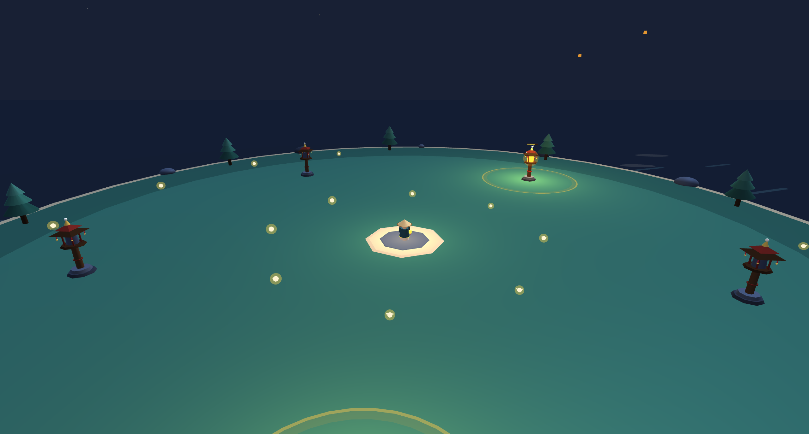

# Đảo Đèn Lồng (v1.0.0)

> **Video demo:** Đính kèm tại GitHub Release `v1.0.0` (xem mục Releases của repo public).

Game 3D góc nhìn thứ ba qua ba đêm: **Đảo Bến**, **Đảo Cau** và **Đảo Chuông**. Nhập vai **Mây**, thu gom đom đóm, châm nhiên liệu bảo đăng, đẩy lùi Bóng Mực hút dầu và Gió Lạc để giữ ít nhất 60% số đèn sáng tới bình minh.



## Yêu cầu hệ thống

- **Node.js 20+** (không cần thư viện runtime bên ngoài, không cần Python).
- **Google Chrome / Chromium** có hỗ trợ WebGL 1.0 (cho chế độ chơi 3D và benchmark `1280×720`).
- Hệ điều hành: macOS hoặc Linux.

## Cài đặt và chạy nhanh (tối đa 3 lệnh từ clone sạch)

```bash
npm run build
npm test
node src/server.mjs
```

Mở <http://127.0.0.1:4173> trên trình duyệt để chơi (nhấn `Ctrl+C` để dừng server).

## Điều khiển & Dễ tiếp cận (Accessibility)

- `W A S D`: di chuyển theo góc nhìn camera; kéo chuột trên khung game để xoay góc nhìn.
- `Space`: nhảy · `Shift`: lướt · `E`: thắp đèn / châm dầu · `Q`: Tỏa Sáng · `P` / `Esc`: tạm dừng.
- **Cài đặt & Dễ tiếp cận** (tất cả được lưu cục bộ trong `localStorage`):
  - **Đổi phím** cho toàn bộ 9 hành động, tự phát hiện trùng phím và có nút **Khôi phục mặc định**.
  - **Bảng màu dễ phân biệt** (viền xanh lam `#00C8FF` cho Bóng Mực, cảnh báo trắng + `⚠`).
  - **Phụ đề & chỉ báo hình ảnh**: Bóng Mực xuất hiện (kèm mũi tên chỉ hướng ở mép màn hình), gió sắp thổi, 10 giây cuối, đèn có `fuel < 30`.
  - **Giảm chuyển động**: tắt hiệu ứng rung/xoay nền và chớp màn hình.
  - **Cỡ chữ UI tối thiểu `18 px` ở `1280×720`** và tùy chọn **Chữ lớn (`×1.25`)**.

## Luật điểm (Contract v1.3)

`+5` mỗi đom đóm nạp hoặc châm dầu, `+100` khi thắp lần đầu, `+40` khi thắp lại. Tỏa Sáng được `+5` mỗi Bóng Mực, hoặc tổng `+15` nếu Bóng Mực đang hút dầu. Khi sống tới bình minh với `≥ 60%` đèn còn sáng: cộng `50 + floor(fuel)` cho mỗi đèn sáng và `+50` cho mỗi Ngọn Lửa còn lại.

## Chạy Test, Headless, Benchmark, Soak & Bảng xếp hạng

Contract đầy đủ nằm ở [`game.contract.json`](game.contract.json) (`contract_version: "1.3"`).

```bash
# 1. Toàn bộ kiểm chứng tự động (CP0, build, 38 tests, tất định, hiệu năng Đêm 3, export BXH, soak smoke)
npm run verify

# 2. Chế độ Headless (Đêm 1: 14400 ticks / Đêm 2: 16200 / Đêm 3: 18000)
node src/headless.mjs --seed 42 --night 1 --ticks 14400 --snapshot-every 60 --out /tmp/night.jsonl

# 3. Chế độ Benchmark chuẩn 1280×720 (3 s khởi động + 30 s đo, 200 Bóng Mực + 100 đom đóm + L1–L3 sáng)
node src/bench.mjs --seed 42 --duration 30 --out bench.json

# 4. Soak test 10 Đêm liên tiếp (0 crash, RSS <= 1.2x)
node --jitless --max-semi-space-size=1 --expose-gc src/soak.mjs --seed 7 --nights 10 --out soak.json

# 5. Xuất Bảng xếp hạng cục bộ (Top 10 JSON)
node src/server.mjs --export-leaderboard out.json

# 6. Đóng gói bản phát hành v1.0.0 (dist/dao-den-long-v1.0.0.zip)
npm run package
```

> **Ghi chú về VSync khi Benchmark:** `src/bench.mjs` khởi chạy Chrome với cờ `--disable-gpu-vsync --disable-frame-rate-limit` (`vsync_off: true`, đạt **643.1 avg FPS / 290.9 p1-low FPS** ở `1280×720` trên máy Apple M5 trong [`bench.json`](bench.json)). Nếu môi trường compositor của một số hệ điều hành không cho tắt vsync ở cấp trình duyệt, tốc độ khung hình có thể bị giới hạn theo tần số quét màn hình.

## Sáng tạo của tôi

- **Engine 3D WebGL đa nguồn sáng & âm thanh ngũ cung thủ tục 100% không asset ngoài:** Bộ dựng hình [`src/web/renderer.mjs`](src/web/renderer.mjs) tự viết hoàn toàn với pháp tuyến thật từng đỉnh, ma trận xoay TRS, tối đa 8 đèn điểm động (đèn cầm tay của Mây + các bảo đăng đang sáng), ánh sáng viền Fresnel, sương mù biển, nhân vật Mây xoay mượt theo hướng chạy, 3 hòn đảo đặc trưng (Đảo Bến, Đảo Cau với cầu tre không lan can, Đảo Chuông 3 tầng), tia hút dầu 3D, sóng xung kích Tỏa Sáng và âm thanh ngũ cung Web Audio ([`src/web/audio.mjs`](src/web/audio.mjs)).
- **Bằng chứng không phá phần lõi & công bằng khi đo:** `src/sim.mjs` không import bất kỳ mã giao diện nào; `npm run verify` xác nhận đầu ra headless giống nhau từng byte qua nhiều lần chạy, còn `benchMode` tắt toàn bộ vật thể trang trí sáng tạo thêm để đo công bằng trên đúng cảnh chuẩn Ticket-04 ([`bench.json`](bench.json), [`soak.json`](soak.json), [`docs/proof/phase-4/bench-scene-1280x720.png`](docs/proof/phase-4/bench-scene-1280x720.png)).

## Hồ sơ dự án, Bằng chứng & Harness AI

- **Retro tổng kết 4 Phase:** [`docs/notes/retro.md`](docs/notes/retro.md)
- **Đánh giá từng phase, phân tích lỗi AI & ước tính token:** [`docs/notes/ai-log-and-eval.md`](docs/notes/ai-log-and-eval.md)
- **Specs & ADR:** [`phase-1-spec.md`](docs/notes/phase-1-spec.md), [`phase-2-spec.md`](docs/notes/phase-2-spec.md), [`phase-3-spec.md`](docs/notes/phase-3-spec.md), [`phase-4-spec.md`](docs/notes/phase-4-spec.md), [`ADR-001`](docs/notes/ADR-001-phase-3-lantern-lifecycle.md)
- **Bằng chứng từng phase:** [`phase-1`](docs/proof/phase-1/results.md), [`phase-2`](docs/proof/phase-2/results.md), [`phase-3`](docs/proof/phase-3/results.md), [`phase-4`](docs/proof/phase-4/results.md), [`bench.json`](bench.json), [`soak.json`](soak.json)
- **Harness & CI:** [`AGENTS.md`](AGENTS.md), [`.agents/skills/verify-and-proof/SKILL.md`](.agents/skills/verify-and-proof/SKILL.md), [`.githooks/pre-commit`](.githooks/pre-commit), [`.github/workflows/ci.yml`](.github/workflows/ci.yml), [`tools/verify.mjs`](tools/verify.mjs)
- **Bản quyền & Thay đổi:** [`CHANGELOG.md`](CHANGELOG.md), [`CREDITS.md`](CREDITS.md), [`LICENSE`](LICENSE)
